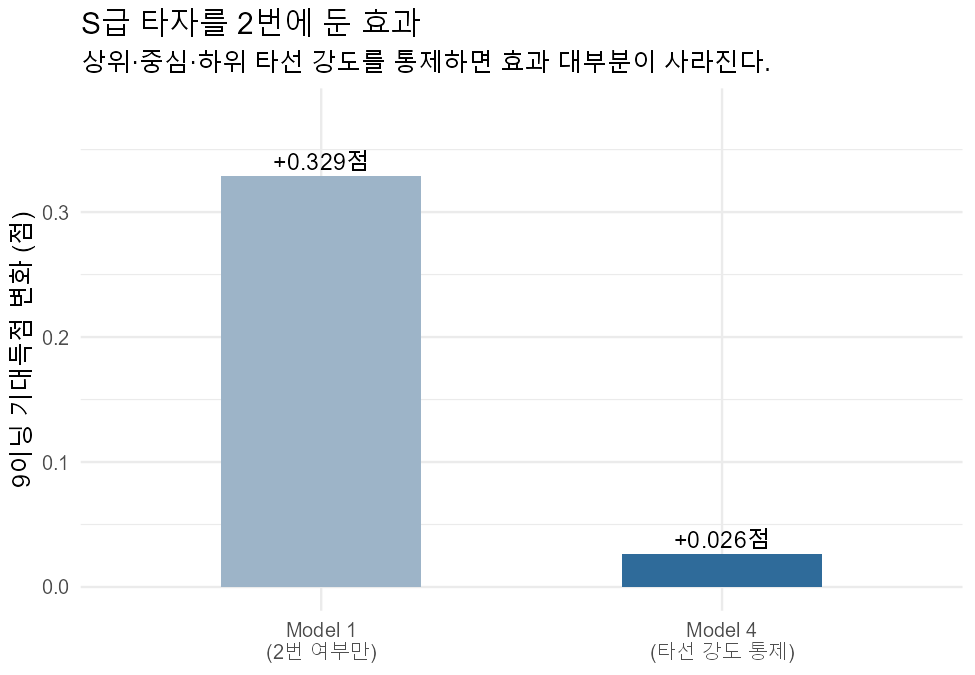
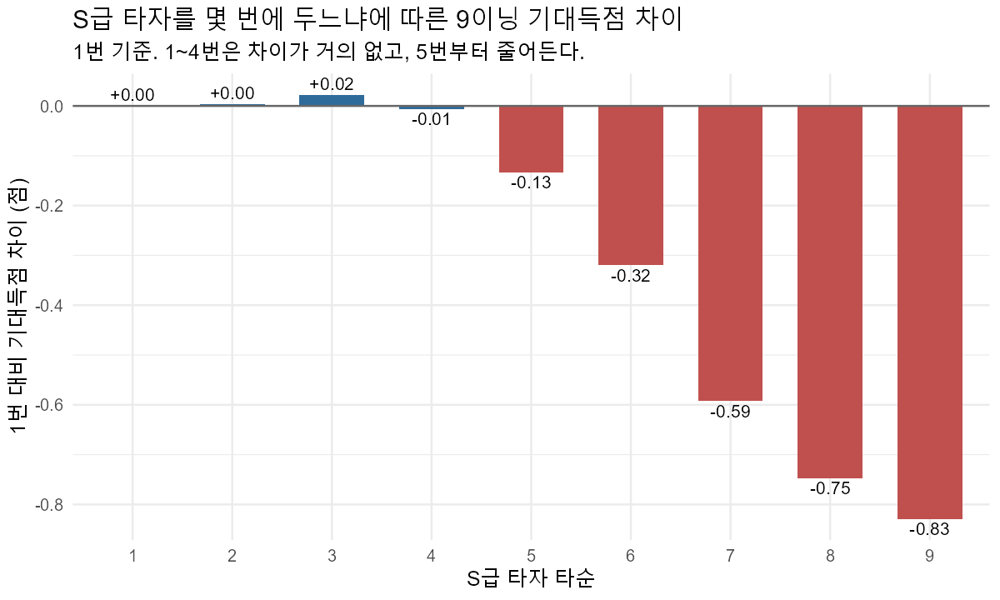

# 강한 2번 타자 이론 검증 (KBO)

"가장 강한 타자를 2번에 두면 득점이 늘어난다"는 강한 2번 타자 이론을, 가능한 라인업 5,040개 전체에 대한 회귀분석으로 다시 검증한 프로젝트입니다.
스포츠 통계 동아리 PAINS 11기 학기 프로젝트(야구 1조, 6명)로 진행했습니다.

- 사용 언어: R (lm, dplyr, ggplot2, broom)
- 기간: 2026년 5월

## 결론

**S급 타자를 2번에 두면 기대득점이 오르지만, 그 효과는 대부분 '2번 자리'가 아니라 '강한 타자를 앞쪽 타순에 두는 것'에서 나옵니다.**

- S급 타자가 2번인지만 보면 9이닝 기대득점이 +0.329점 높았습니다.
- 1~3번, 3~5번, 6~9번 타선의 강도를 함께 넣으면 그 효과가 +0.026점으로 줄었습니다.
- S급 타자는 1~4번 어디에 두든 차이가 거의 없었고, 5번부터 줄어 9번에서는 1번 대비 0.83점 낮았습니다.



## 데이터

타자를 wRC+ 기준으로 네 등급으로 나누고, 등급별 타격 결과 확률로 마르코프 체인 시뮬레이션을 돌려 라인업별 9이닝 기대득점을 계산했습니다.

| 등급 | 기준 | 인원 |
| --- | --- | --- |
| S | wRC+ 140 이상 | 1명 |
| A | wRC+ 115~140 | 2명 |
| B | wRC+ 100~115 | 3명 |
| C | wRC+ 100 미만 | 3명 |

이 9명으로 만들 수 있는 라인업은 9! / (1!·2!·3!·3!) = 5,040개입니다. 시뮬레이션은 같은 조의 다른 팀이 만들었고, 이 저장소는 그 결과를 회귀분석한 부분입니다.

`data/lineup_5040_expected_runs.csv`는 시뮬레이션 결과 파일에서 분석에 쓰는 열만 남긴 것입니다. 원본에는 타순 문자열 열 두 개가 잘못 생성되어 파일이 300MB가 넘었기 때문에 그 두 열을 뺐습니다.

## 모델

| 모델 | 질문 | 결과 | R² |
| --- | --- | --- | --- |
| Model 1 | S급 타자가 2번이면 기대득점이 높아지는가? | +0.329점 | 0.048 |
| Model 2 | S·A급 타자가 2번이면 높아지는가? | +0.309점 | 0.095 |
| Model 3 | 1~3번과 3~5번 중 어디가 더 중요한가? | 1~3번 +0.119, 3~5번 +0.016 | 0.760 |
| Model 4 | 타선 강도를 통제해도 S급 2번 효과가 남는가? | +0.026점 | 0.760 |
| **Model 5** | S급 타자의 위치(1~9번) 자체가 기대득점을 바꾸는가? | 1~4번 차이 없음, 5번부터 감소 | 0.478 |
| **Model 6** | 2번 타자의 등급별로 기대득점이 어떻게 다른가? | A급 대비 S +0.129, B −0.246, C −0.287 | 0.102 |

**Model 5, 6을 추가한 이유**

- Model 4의 `top123_strength`는 1~3번의 평균이라 S급이 1번에 있든 2번에 있든 같은 값이 됩니다. 그래서 Model 4만으로는 "2번이라서 좋은지"를 가릴 수 없었습니다. Model 5는 S급 타자의 위치를 1~9번으로 직접 비교합니다.
- Model 1, 2는 2번 타자가 강한지 여부만 봤습니다. Model 6은 2번 타자의 등급을 S·A·B·C로 나눠 비교합니다.



## 한계

- 실제 경기 데이터가 아니라 시뮬레이션 결과를 분석했습니다. 실제 KBO 라인업 데이터로 확인하는 것은 후속 과제입니다.
- 시뮬레이션은 1루타는 1베이스, 2루타는 2베이스처럼 주자 진루를 고정해서 계산했습니다.
- 상대 투수, 구장, 수비 같은 요인은 반영하지 않았습니다.
- 5,040개 라인업은 같은 선수를 재배치한 결과라 서로 독립적인 관측치가 아닙니다. 그래서 p-value보다 계수의 방향과 크기로 해석했습니다.

## 실행 방법

```r
# install.packages(c("dplyr", "ggplot2", "broom"))
```

```bash
Rscript R/regression_models.R
```

실행하면 `output/model_summary.csv`에 모델별 계수가, `figures/`에 그래프가 저장됩니다.

## 팀과 역할

| 구분 | 담당 |
| --- | --- |
| 마르코프 체인 시뮬레이션 | 같은 조 1팀 |
| 회귀분석 기본 코드 (Model 1~4) | 2팀 팀원 |
| Model 5, 6 설계와 해석 | 박하연 (2팀) |

이 저장소의 코드는 팀에서 쓴 분석을 다시 정리한 것이며, 결과 숫자는 팀 보고서와 같게 나오는 것을 확인했습니다.
